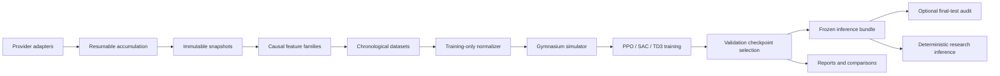

# Architecture and ownership

The package follows the module map in `plan.md`. One symbol is traded per episode. One policy can train across the four ETF episodes; simultaneous multi-asset portfolio allocation requires a new environment/action version.

Generated market datasets and artifacts are ignored at the repository root
(`/data/`, `/artifacts/`). The implementation in `src/rl_stocks/data/` is tracked
source code and must remain available in fresh checkouts.

| Module | Owns | Does not own |
| --- | --- | --- |
| `core` | Frozen typed contracts, schemas, identities, atomic writes | SDK calls or mutable portfolio state |
| `data/providers` | Provider-specific retrieval and source representation | Indicators, environments or orders |
| `data/accumulation` | Chunk cursors, retry bounds, provenance and coverage | Algorithm selection |
| `data/validation` | Timestamp/OHLC quality and exchange-session coverage | Silently filling absent prices |
| `data/storage` | Content-addressed snapshots and derived Parquet | Rewriting revisions in place |
| `data/generation` | Feature assembly, splits, fitted normalizer and manifest | Calling providers during training |
| `features/*` | Individual causal feature families | Future labels or portfolio rewards |
| `environment/accounting` | Cash, shares, basis, costs and event ledger | Policy learning |
| `environment/execution` | Next-open/protective simulation and risk gate | Broker APIs |
| `environment/trading` | Gymnasium observations, reset/step and boundary semantics | Market-data retrieval |
| `environment/rewards` | Net-equity reward | Hard exposure constraints |
| `risk` | Action decoding and executable-price geometry | Reward shaping |
| `rl/*` | Shared factory and separate algorithm settings | Test-set selection |
| `training` | Seeds, checkers, checkpoints, validation selection, run metadata | Live inference scheduling |
| `evaluation` | Deterministic validation/test paths and baselines | Training normalization updates |
| `inference` | Bundle validation and frozen prediction | Learning or replay-buffer mutation |
| `reporting` | HTML/JSON views and matched seed comparisons | Replacing evaluation metrics |
| `runtime` | Local CLI and owned Colab lifecycle | Persistent live trading uptime |

Imports must remain side-effect free: importing a provider does not authenticate, download data or create a session. Optional Yahoo/Alpaca libraries are imported only inside their adapter calls. No broker SDK is required for the baseline dataset/environment.

Reuse modules from thin scripts or future notebooks. Extend one family at a time, add an explicit feature/action version, record a matched ablation and retrain the bundle when its schema changes. Data provider changes must preserve canonical contracts and remain visible in manifests; feed harmonization is a separate audited experiment.

Runs record the source revision and dirty status when Git metadata is available.
Frozen worker exports retain their verified source identity. Missing Git metadata
is recorded explicitly rather than replaced with an invented revision.

## Experiment files and generated evidence

Keep reusable feature math in `features/`, dataset preparation in
`data/generation/`, and fixed study contracts in `training/`. Numeric experiment
definitions belong in `configs/experiments/`; untrained shared tensors and their
checksum manifests belong in `configs/initializations/`. Colab orchestration and
retrieval checks live in `runtime/colab/`, with study-specific validation in
separate modules when it would crowd the common lifecycle code.

Scripts are command entry points that call package modules. Tests live under
`tests/`; category guides live under `docs/`. Each study's compact, committed
evidence belongs in its dated `results/` directory with a README linking the
method, limitations and machine-readable results. Large models, derived HTML,
transports and immutable market data stay in ignored `artifacts/` and `data/`
directories; checksummed public release assets provide durable distribution.
Private controller state, logs, ledgers and temporary exports stay in ignored
`.runtime/`. Preserve retained artifact paths and historical evidence when
organizing code; move files only with their imports, references and checks.

## Why `src/rl_stocks/` exists

`src/` is the source container and `rl_stocks/` is the importable Python package.
This keeps imports under one namespace, such as `rl_stocks.inference`, and lets
the package installer discover the project through `pyproject.toml`. It also
helps tests exercise installed package discovery instead of accidentally importing
files from the checkout root. Moving every module directly under `src/` would
require a coordinated import/build migration and create separate top-level module
names. Keep application categories inside the `rl_stocks` package.
